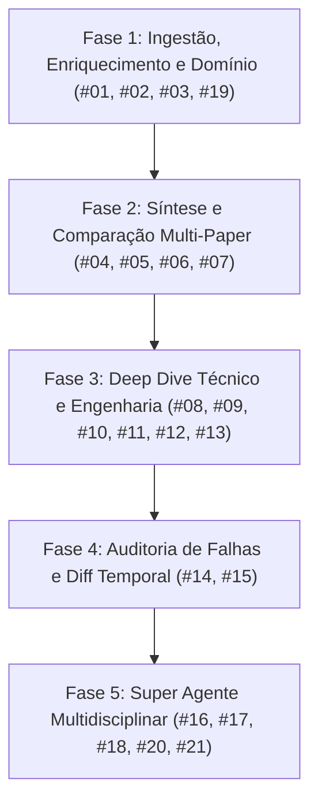

# Noul Search Agent: Arquitetura Técnica e Especificação de Implementação

> **Documento Canônico de Engenharia e Especificação de Backlog**  
> **Status:** Pronto para Implementação via Antigravity / GitHub Copilot / Sprint Plan  
> **Versão:** 2.0.0-PRO (Stack Oficial MCP: `uvx` + `FastMCP` + `Pydantic v2` + `httpx` + `Typer`/`Rich`)

---

## 1. Visão Geral e Princípios Arquiteturais

O **Noul Search Agent** é um assistente autônomo e motor de inteligência científica projetado para atuar no ciclo completo de pesquisa: desde a descoberta e filtragem inicial até a auditoria metodológica profunda e geração de código funcional ou protocolos experimentais.

### 1.1. Modos de Operação e Distribuição Padrão (`uvx` / `uv`)
1. **Interface de Linha de Comando (CLI)** (`noul_cli.py` / `uvx noul-search-agent`): Operação interativa e automatizada em terminal via **Typer** com formatação **Rich**.
2. **Model Context Protocol (MCP)** (`noul_mcp.py` / `uvx --from noul-search-agent noul-mcp`): Servidor **FastMCP** (SDK oficial `mcp`) expondo ferramentas tipadas, recursos e prompts para Claude Code, Claude Desktop, Antigravity, Gemini CLI, GitHub Copilot, Codex e ChatGPT.
3. **Plugin Bundle Nativo** (`plugin.json` e `.claude-plugin/plugin.json`): Empacota MCP Server + Skill (`skills/noul-search/SKILL.md`) + Subagent (`agents/`) + Commands (`commands/`) em uma unidade instalável via `uv run` / `uvx`.
4. **Módulos Centrais Desacoplados** (`noul/`): Pacote Python assíncrono tipado com **Pydantic v2**, consumível também por backends web externos.

### 1.2. Princípios de Engenharia e Segurança
- **Desacoplamento Estrito:** A lógica analítica do agente não depende de infraestrutura web externa (Postgres, filas Celery ou frontend).
- **Contratos Tipados (Type-Safety):** Todas as entradas, saídas e comunicações entre ferramentas utilizam modelos **Pydantic v2** (`noul/schemas/`), garantindo validação automática de schemas no MCP e na CLI.
- **Execução Híbrida (Extração Determinística + Host LLM / MCP Sampling):** Os provedores e ferramentas em `noul/` realizam toda a extração determinística pesada (metadados, PDF/LaTeX/JATS XML, equações, tabelas, cálculo matemático de VRAM/KV Cache, diff de versões do arXiv, validação HTTP 200 de repositórios e validação `ast.parse`) e estruturam rubricas por domínio (CONSORT/STROBE, Identificação Causal, NeurIPS/ICLR), podendo usar `ctx.sample()` do MCP ou retornar contratos estruturados para o LLM hospedeiro.
- **Blindagem de Segurança (Requisitos P0):**
  - **Proteção Anti-SSRF:** Todas as requisições HTTP externas (`httpx`) validam que o host resolvido não pertence a faixas privadas, loopback ou link-local (`127.0.0.0/8`, `169.254.169.254`, RFC1918).
  - **Confinamento de Workspace:** Operações de escrita em disco (downloads de PDFs, exportação Obsidian, dossiês) ficam estritamente confinadas ao `NOUL_WORKSPACE` (bloqueando path traversal e symlinks externos).
  - **Regex Estrita de DOI:** Identificadores arXiv de outubro (`2410.12345`) nunca são confundidos com prefixos DOI (`^10\.\d{4,9}/`).

---

## 2. Estrutura de Diretórios e Módulos

```text
ernanedomingues-noul-search-agent/
├── pyproject.toml                    # Configuração uv/PyPI (mcp, pydantic, httpx, typer, rich, pypdf)
├── package.json                      # Wrapper npx opcional (delega para uvx / python)
├── plugin.json                       # Manifesto de Plugin (Antigravity)
├── .claude-plugin/
│   └── plugin.json                   # Manifesto de Plugin (Claude Code)
├── Dockerfile                        # Container Cloud Run (uv + Streamable HTTP)
├── noul_cli.py                       # Interface CLI (Typer + Rich)
├── noul_mcp.py                       # Servidor MCP (FastMCP + retrocompatibilidade JSON-RPC)
├── noul_core.py                      # Facade de retrocompatibilidade para noul/
├── noul_tools.py                     # Registro unificado de tools para MCP e CLI
├── install.py                        # Instalador multi-agente (preferindo uvx / uv run)
├── noul/                             # Pacote modular central
│   ├── __init__.py
│   ├── config.py                     # Configurações persistentes (config.json), chaves BYOK e env vars
│   ├── core.py                       # Orquestrador do pipeline de busca e raciocínio
│   ├── schemas/                      # Contratos de dados Pydantic v2
│   │   ├── __init__.py
│   │   ├── domain.py                 # Enums de domínios (ScientificDomain) e vereditos (ReviewVerdict)
│   │   ├── paper.py                  # Entidades canônicas (UnifiedPaper, PaperReference, ArtifactStatus)
│   │   ├── hardware.py               # Modelos de memória VRAM e viabilidade (HardwareFeasibility)
│   │   ├── analysis.py               # Matrizes de comparação e síntese temática
│   │   ├── review.py                 # Relatórios de revisão multi-persona (PeerReviewReport)
│   │   └── code.py                   # Modelos de scaffolding e testes (CodeScaffold)
│   ├── providers/                    # Clientes de APIs acadêmicas e parsers (httpx)
│   │   ├── __init__.py
│   │   ├── domain_classifier.py      # Classificador de domínio por arXiv/MeSH/OpenAlex/Resumo (#19)
│   │   ├── arxiv_client.py           # API arXiv, fonte TeX e diffs de versões v1 vs v2 (#15)
│   │   ├── semantic_scholar.py       # API Semantic Scholar e grafo de citações influentes (#03)
│   │   ├── openalex_client.py        # API OpenAlex aberta
│   │   ├── pubmed_client.py          # API NCBI PubMed / EuropePMC (MeSH + XML JATS)
│   │   ├── artifact_radar.py         # Validador HTTP de repositórios GitHub/HF/Zenodo/Kaggle (#02)
│   │   └── pdf_parser.py             # Extração de seções, equações, tabelas e grounding (#08, #10-#14)
│   ├── tools/                        # Ferramentas atômicas expostas ao MCP e CLI
│   │   ├── __init__.py
│   │   ├── search_tools.py           # Clarificação (#01), busca, referências (#03) e expansão booleana (#07)
│   │   ├── comparative_tools.py      # Matriz comparativa (#04), insights (#05), Obsidian (#06) e lacunas (#18)
│   │   ├── technical_tools.py        # Tabelas (#08), grounding (#10), matemática (#11), ablação (#12), prompts (#13), falhas (#14)
│   │   ├── hardware_tools.py         # Estimativa de VRAM, KV Cache e arquitetura (#09)
│   │   ├── review_tools.py           # Comitê antagônico multi-persona adaptável por domínio (#17, #20)
│   │   └── scaffold_tools.py         # Gerador poliglota de código e protocolos com verificação (#16, #21)
│   └── prompts/                      # Rubricas e templates de instruções
│       ├── __init__.py
│       ├── clarification.py
│       ├── rubrics_cs.py             # Rubrica NeurIPS / ICLR
│       ├── rubrics_biomedical.py     # Rubrica CONSORT / STROBE
│       ├── rubrics_economics.py      # Rubrica de identificação causal (DiD, RDD, IV)
│       └── scaffolding.py
├── skills/
│   └── noul-search/
│       └── SKILL.md
├── agents/
├── commands/
│   └── noul-search-config.md
├── docs/
│   ├── IMPLEMENTATION_PLAN.md
│   ├── ROADMAP.md
│   └── TECHNICAL_SPECIFICATION.md    # [Este documento]
└── tests/                            # Suíte de testes offline (pytest + unittest)
    ├── test_agent.py                 # Suíte de regressão P0 existente (22 testes)
    ├── test_domain_classifier.py
    ├── test_hardware_estimator.py
    ├── test_comparative_matrix.py
    ├── test_review_committee.py
    └── test_scaffolders.py
```

---

## 3. Contratos de Dados Centrais (Pydantic v2 Schemas)

### 3.1. Domínios Científicos (`noul/schemas/domain.py`)
```python
from enum import Enum


class ScientificDomain(str, Enum):
    COMPUTER_SCIENCE = "computer_science"
    BIOMEDICAL = "biomedical"
    ECONOMICS = "economics"
    GENERAL_STEM = "general_stem"


class ReviewVerdict(str, Enum):
    ACCEPT = "accept"
    ACCEPT_WITH_RESERVATIONS = "accept_with_reservations"
    BORDERLINE = "borderline"
    REJECT = "reject"
```

### 3.2. Artigo Canônico e Artefatos (`noul/schemas/paper.py`)
```python
from datetime import date
from typing import List, Optional
from pydantic import BaseModel, Field, HttpUrl
from noul.schemas.domain import ScientificDomain


class PaperReference(BaseModel):
    paper_id: str
    title: str
    authors: List[str] = Field(default_factory=list)
    year: Optional[int] = None
    venue: Optional[str] = None
    citation_count: int = 0
    is_influential: bool = False
    doi: Optional[str] = None
    url: Optional[str] = None


class ArtifactStatus(BaseModel):
    has_code: bool = False
    code_url: Optional[HttpUrl] = None
    code_verified: bool = False
    has_weights: bool = False
    weights_url: Optional[HttpUrl] = None
    has_dataset: bool = False
    dataset_url: Optional[HttpUrl] = None
    evasive_availability_statement: bool = False


class UnifiedPaper(BaseModel):
    id: str
    title: str
    abstract: str = ""
    authors: List[str] = Field(default_factory=list)
    year: Optional[int] = None
    published_date: Optional[date] = None
    venue: Optional[str] = None
    domain: ScientificDomain = ScientificDomain.GENERAL_STEM
    primary_category: str = "general"
    evidence_level: str = "other"
    citation_count: int = 0
    open_access: bool = False
    pdf_url: Optional[str] = None
    doi: Optional[str] = None
    pmid: Optional[str] = None
    arxiv_id: Optional[str] = None
    artifacts: ArtifactStatus = Field(default_factory=ArtifactStatus)
    backward_citations: List[PaperReference] = Field(default_factory=list)
    forward_citations: List[PaperReference] = Field(default_factory=list)
    bibtex: Optional[str] = None
```

### 3.3. Viabilidade de Hardware (`noul/schemas/hardware.py`)
```python
from typing import Literal, Optional
from pydantic import BaseModel


class PrecisionMemory(BaseModel):
    weights_gb: float
    kv_cache_8k_context_gb: float
    recommended_min_vram_gb: float


class HardwareFeasibility(BaseModel):
    paper_id: str
    total_parameters_billion: float
    active_parameters_billion: Optional[float] = None
    architecture_type: Literal["dense", "moe", "encoder_only", "rnn_ssm"] = "dense"
    fp16: PrecisionMemory
    int8: PrecisionMemory
    int4: PrecisionMemory
    reported_training_hardware: Optional[str] = None
    operational_tier: Literal["edge_consumer_gpu", "workstation", "datacenter_cluster"]
```

### 3.4. Análise Comparativa, Síntese Temática e Lacunas (`noul/schemas/analysis.py`)
```python
from typing import Any, Dict, List
from pydantic import BaseModel, Field


class ComparisonDimension(BaseModel):
    paper_id: str
    paper_title: str
    core_hypothesis: str
    methodology: str
    benchmarks_used: List[str] = Field(default_factory=list)
    primary_metrics: Dict[str, Any] = Field(default_factory=dict)
    reported_limitations: List[str] = Field(default_factory=list)


class ComparativeMatrixResult(BaseModel):
    papers: List[ComparisonDimension]
    divergence_summary: str
    convergence_summary: str
    markdown_table: str


class ThematicInsightsResult(BaseModel):
    topic: str
    consolidated_consensuses: List[str]
    methodological_tensions: List[str]
    emerging_future_work: List[str]
    citations_map: Dict[str, List[str]] = Field(default_factory=dict)


class ResearchHypothesis(BaseModel):
    title: str
    rationale: str
    source_papers: List[str]
    proposed_methodology: str
    required_baselines: List[str]
    target_datasets_or_population: List[str]
    evaluation_metrics: List[str]


class ResearchGapReport(BaseModel):
    contradictions_found: List[str]
    unexplored_complementarities: List[str]
    hypotheses: List[ResearchHypothesis]
```

### 3.5. Auditoria de Revisores e Scaffolder Poliglota (`noul/schemas/review.py` e `noul/schemas/code.py`)
```python
from typing import List
from pydantic import BaseModel, Field
from noul.schemas.domain import ReviewVerdict


class PersonaEvaluation(BaseModel):
    persona_role: str
    strengths: List[str]
    critical_flaws: List[str]
    unverified_claims: List[str]
    confidence_score: float = Field(ge=1.0, le=5.0)


class PeerReviewReport(BaseModel):
    paper_id: str
    domain_evaluated: str
    rubric_applied: str
    verdict: ReviewVerdict
    executive_summary: str
    evaluations: List[PersonaEvaluation]
    meta_reviewer_notes: str
    missing_experiments_or_controls: List[str]


class CodeScaffold(BaseModel):
    paper_id: str
    domain: str
    language: str
    framework: str
    source_code: str
    unit_tests: str
    syntax_valid: bool = True
    dependencies: List[str] = Field(default_factory=list)
    execution_notes: str = ""
```

---

## 4. Backlog de Implementação: As 21 Issues Organizadas por Fase



### Fase 1: Ingestão, Enriquecimento e Domínio
- **Issue #19 — Mecanismo de Detecção de Domínio Científico (`ScientificDomain`)**:
  - Mapeia categorias arXiv (`cs.*`, `stat.ML`, `econ.*`, `q-fin.*`, `q-bio.*`), metadados PubMed/MeSH, conceitos OpenAlex/S2 e análise léxica de título/resumo para `COMPUTER_SCIENCE`, `BIOMEDICAL`, `ECONOMICS` ou `GENERAL_STEM`. Suporta override `--domain`.
- **Issue #01 — Refinamento Interativo de Escopo via Perguntas (*Clarification Loop*)**:
  - Detecta consultas genéricas (baixa especificidade) e gera 2–3 perguntas com alternativas rápidas antes da busca, com suporte às flags `--skip-clarification` e `--skip-clarify`.
- **Issue #02 — Radar de Artefatos Abertos (*Code, Weights & Datasets Radar*)**:
  - Extrai links de GitHub, GitLab, Hugging Face, Zenodo, Figshare e Kaggle do texto/metadados, valida status HTTP 200 (respeitando proteção anti-SSRF), preenche `has_code`, `has_weights`, `has_dataset` e detecta frases evasivas (*"available upon reasonable request"*).
- **Issue #03 — Extração de Referências e Grafo de Citações (`get_paper_references`)**:
  - Tool `get_paper_references(paper_id: str, limit: int = 10, direction: str = "both", sort_by: str = "influential")` integrando Semantic Scholar (`isInfluential`) e OpenAlex.

### Fase 2: Síntese e Comparação Multi-Paper
- **Issue #04 — Matriz Comparativa Parametrizada (`compare_papers` / `noul compare`)**:
  - Seleciona $k$ artigos (padrão 3–5) e cruza: *Problema Central, Abordagem Metodológica, Datasets/Benchmarks, Resultados Chave e Limitações Declaradas*, gerando tabela Markdown alinhada e síntese narrativa de divergências.
- **Issue #05 — Extração e Síntese Temática de Insights (`get_thematic_insights`)**:
  - Categoriza descobertas do corpus em: (1) *Consensos Consolidados*, (2) *Discrepâncias e Tensões Metodológicas* e (3) *Direções Futuras e Lacunas*, com citações `[Autor et al., Ano]`.
- **Issue #06 — Exportação Estruturada para Fichamento em Markdown / Obsidian**:
  - Gera notas atômicas com Frontmatter YAML válido, bloco `@article` BibTeX, TL;DR e wikilinks `[[Paper]]`. Suporta `--export-obsidian <caminho>` e `noul export <id> --vault-dir <caminho>`.
- **Issue #07 — Expansão Dinâmica de Pesquisa e Sugestão de Consultas Booleanas (`suggest_boolean_queries`)**:
  - Analisa entidades técnicas e acrônimos dos resultados e retorna 2–3 queries booleanas (`AND`, `OR`, `NOT`) acionáveis por índice no CLI.

### Fase 3: Deep Dive Técnico & Métricas de Engenharia
- **Issue #08 — Extrator e Normalizador de Tabelas de Benchmarks (`extract_benchmark_tables`)**:
  - Extrai tabelas experimentais (de fonte TeX/XML ou PDF), preservando linhas/colunas e normalizando métricas conhecidas (MMLU, GSM8K, HumanEval, BLEU, F1, AUC, Latency).
- **Issue #09 — Estimador de Viabilidade de Hardware e Pegada de Inferência (`estimate_hardware_specs`)**:
  - Extrai parâmetros totais/ativos e calcula VRAM para FP16, INT8 e INT4 + KV Cache para contexto de 8k tokens:
    $$\text{Memória KV (bytes)} = 2 \times \text{layers} \times \text{heads} \times d_{\text{head}} \times \text{seq\_len} \times \text{bytes\_per\_element}$$
  - Classifica em `edge_consumer_gpu` ($\le 16\text{ GB}$), `workstation` ($16\text{–}48\text{ GB}$) ou `datacenter_cluster` ($> 48\text{ GB}$).
- **Issue #10 — Verificação de Evidências e Atribuição Estrita (*Grounding & Fact Check*) (`verify_paper_claims`)**:
  - Vincula métricas e afirmações ao formato `[pág. X, Tabela Y: "...trecho verbatim..."]` e sinaliza extrapolações não literais.
- **Issue #11 — Extração de Pseudocódigo e Formulações Matemáticas (`extract_paper_math`)**:
  - Tool `extract_paper_math(paper_id: str, mode: Literal["latex", "python"] = "latex")` extraindo equações e blocos `Algorithm` em LaTeX limpo ou protótipo Python tipado com docstrings.
- **Issue #12 — Mapeador de Estudos de Ablação (`analyze_ablation_tables`)**:
  - Isola tabelas de ablação, calcula o impacto $\Delta\%$ de cada componente sobre o baseline e alerta sobre ganhos marginais.
- **Issue #13 — Extrator de Templates de Prompt e Protocolos de Inferência (`extract_prompts_and_decoding`)**:
  - Extrai system prompts, templates `{variavel}` e hiperparâmetros (`temperature`, `top_p`, `max_tokens`) de apêndices e seções metodológicas.

### Fase 4: Auditoria Crítica & Análise Temporal
- **Issue #14 — Detector de Casos de Falha e Premissas Críticas (`detect_failure_modes`)**:
  - Mapeia cenários de degradação (contexto longo, ruído, OOD, latência) e condições em que baselines clássicos superam o método proposto.
- **Issue #15 — Analisador de Diferenças entre Versões do Artigo (`diff_arxiv_versions` / `noul diff`)**:
  - Compara revisões distintas no arXiv (ex.: `2401.12345v1` vs `2401.12345v2`) destacando alterações em números, tabelas, autores e atenuação de alegações.

### Fase 5: Super Agente Autônomo e Multidisciplinar
- **Issue #20 (engloba #17) — Motor de Revisão Crítica Multi-Persona Adaptável por Domínio (`review_paper` / `noul review`)**:
  - Instancia 3 personas rigorosas + Meta-Reviewer adaptadas ao domínio detectado (#19):
    - `COMPUTER_SCIENCE` (**Issue #17**): *Revisor Teórico*, *Revisor Empírico Cético* e *Engenheiro de Sistemas* sob critérios NeurIPS/ICLR;
    - `BIOMEDICAL`: *Metodologista Clínico (CONSORT/STROBE)*, *Bioestatístico* e *Revisor de Desfechos Clínicos*;
    - `ECONOMICS`: *Econometrista de Identificação Causal (DiD/RDD/IV)*, *Auditor de Dados/Endogeneidade* e *Avaliador de Política Pública*;
    - `GENERAL_STEM`: *Revisor Metodológico*, *Auditor Estatístico* e *Revisor de Reprodutibilidade*.
  - Exposta no MCP como `review_paper` (e alias `review_paper_scientific`) e na CLI como `noul review <id> [--domain D]`.
- **Issue #21 (engloba #16) — Scaffolder Poliglota de Código e Protocolos Experimentais (`scaffold_implementation` / `noul scaffold`)**:
  - Adaptável ao domínio:
    - `COMPUTER_SCIENCE` (**Issue #16**): Gera classe `torch.nn.Module` tipada com `forward`, testes unitários com dummy tensors (`assert out.shape == expected_shape`) e validação sintática via `ast.parse`;
    - `ECONOMICS`: Gera script Python (`statsmodels`/`linearmodels`) ou R com regressões, erros-padrão agrupados e matriz de testes de robustez + dados sintéticos;
    - `BIOMEDICAL` / `GENERAL_STEM`: Gera protocolo clínico/experimental passo a passo, critérios de elegibilidade e pipeline analítico padronizado.
  - Exposta no MCP como `scaffold_implementation` (e alias `scaffold_paper_code`) e na CLI como `noul scaffold <id> [--target pytorch|statsmodels|r|protocol]`.
- **Issue #18 — Motor Autônomo de Lacunas e Geração de Hipóteses (`generate_research_hypotheses`)**:
  - Cruza múltiplos artigos da mesma trilha para detectar contradições ou complementariedades inexploradas e gera hipóteses formais com desenho experimental sugerido (baselines, métricas e datasets/população).

---

## 5. Configuração Oficial de Empacotamento (`pyproject.toml` + `uvx`)

```toml
[build-system]
requires = ["setuptools>=77"]
build-backend = "setuptools.build_meta"

[project]
name = "noul-search-agent"
version = "2.0.0"
description = "Autonomous multi-disciplinary scientific research agent (MCP server, CLI, skill & subagent) with Evidence Meter, peer-review committee, hardware estimator and polyglot code/protocol scaffolder."
readme = "README.md"
requires-python = ">=3.10"
license = "Apache-2.0"
dependencies = [
    "mcp>=1.6.0",
    "pydantic>=2.7.0",
    "httpx>=0.27.0",
    "typer>=0.12.0",
    "rich>=13.7.0",
    "pypdf>=4.0.0",
]

[project.scripts]
noul = "noul_cli:main"
noul-search-agent = "noul_cli:main"
noul-mcp = "noul_mcp:main"
noul-install = "install:main"
```

### Padrão de Configuração MCP com `uvx` / `uv run`
- **Instalado via PyPI (`uvx`)**:
  ```json
  {
    "mcpServers": {
      "noul": {
        "command": "uvx",
        "args": ["--from", "noul-search-agent", "noul-mcp"]
      }
    }
  }
  ```
- **Desenvolvimento Local / Clone de Repositório (`uv run`)**:
  ```json
  {
    "mcpServers": {
      "noul": {
        "command": "uv",
        "args": ["run", "--directory", "/caminho/para/noul-search-agent", "noul-mcp"]
      }
    }
  }
  ```
